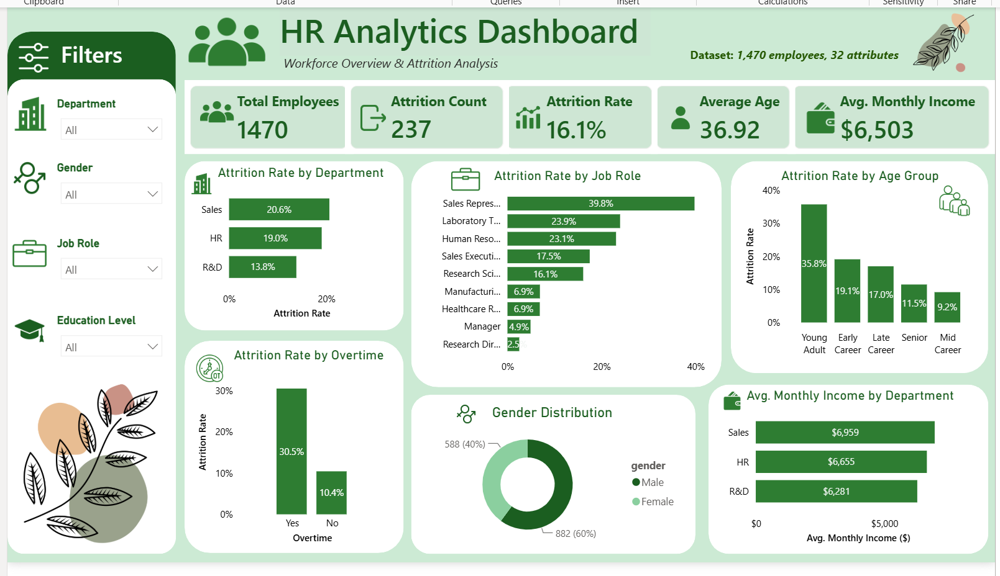

# HR Employee Attrition Analysis

End-to-end analysis of employee attrition for 1,470 employees using **Python, PostgreSQL, SQL, Power BI and a logistic regression model**. The project finds who leaves, which factors go with leaving, and what HR could do about it.




## Project snapshot
| | |
|---|---|
| Domain | HR analytics |
| Data | 1,470 employees, 35 original columns (IBM HR Analytics sample dataset, fictional data, [add Kaggle link]) |
| Tools | Python (pandas, scikit-learn, matplotlib, seaborn), PostgreSQL, SQL, Power BI |
| Deliverables | Analysis notebook, SQL queries, 2-page Power BI dashboard, attrition model |

## Business questions
1. What is the attrition rate, and where is it highest?
2. Which factors (overtime, pay, role, age, travel, satisfaction) go with leaving?
3. Can we predict which employees are at risk, and how well?
4. What should HR do first?

## Key findings
237 of 1,470 employees left, an overall attrition rate of **16.12%**.

- **Overtime is the strongest signal.** 30.5% of employees working overtime left vs 10.4% of those who do not. The gap holds in every department (Sales 37.5% vs 13.8%, R&D 27.3% vs 8.6%, HR 29.4% vs 15.2%), and overtime staff earn about the same as others, so it is not just a pay effect.
- **Young and entry-level employees leave most.** Ages 18-25 leave at 35.8% (mid-career 36-45: 9.2%). The bottom salary quartile leaves at 29.3% vs about 10% in the top two quartiles.
- **Risk is concentrated in certain roles and departments.** Sales Representatives 39.8% and Laboratory Technicians 23.9% (Research Directors 2.5%). By department: Sales 20.6%, HR 19.0%, R&D 13.8%. R&D has the most leavers (133) only because it is the largest department.
- **Other patterns:** single employees 25.5% vs married 12.5%; frequent travellers 24.9% vs non-travellers 8.0%; employees rating work-life balance "Bad" 31.2%; new hires (0-5 years) 20.9% vs about 11% for longer tenure.
- **No clear pattern** for years since last promotion or training sessions, so they are not used as recommendations.

## Attrition model
A logistic regression predicts whether an employee leaves (80/20 stratified split, features scaled on training data only).

| | Default model | Balanced model |
|---|---|---|
| Accuracy | 86.1% | 75.2% |
| Recall (leavers caught) | 34.0% (16 of 47) | 61.7% (29 of 47) |
| Precision | 61.5% | 34.5% |
| ROC AUC | 0.808 | 0.798 |

Only 16% of employees leave, so predicting "nobody leaves" is already 84.0% accurate. Accuracy alone is misleading, and the models are compared on recall and precision. The **balanced model** is better suited to HR: missing a real leaver costs more than a retention conversation with someone who would have stayed.

Strongest model factors (odds ratios): Laboratory Technician role 2.25 (vs Healthcare Representative), overtime 2.16, frequent travel 2.06 (vs no travel), Sales Representative role 1.70. Overtime and travel agree with the rate analysis. Pay, job level and total working years overlap strongly, so their individual coefficients should not be read alone.

## Recommendations
- Review overtime and workload first, starting with Sales.
- Target retention at entry-level and early-career staff: pay and growth paths.
- Prioritise high-risk roles (Sales Representative, Laboratory Technician).
- Strengthen onboarding for employees in their first five years.
- Check work-life balance and travel load.

## Method
**Data preparation (Python)**
- Standardised column names; checked for missing values and duplicates (none found).
- Dropped three constant columns (`EmployeeCount`, `Over18`, `StandardHours`).
- Feature engineering: age group, income quartile, experience group, distance group, and readable labels for education and the satisfaction scales.

**Analysis (Python + SQL)**
- Attrition **rates** by driver in pandas (not just counts, since counts favour large groups).
- PostgreSQL queries with aggregation, CTEs and window functions, including rate-based queries (`100.0 *` so decimals are not truncated).

**Dashboard (Power BI)**
- Page 1: KPIs and attrition rate by department, job role, age group and overtime, with slicers synced to page 2.
- Page 2: attrition rate by work-life balance, job, relationship and environment satisfaction, training, experience, income group, plus HR recommendations.

## Limitations
- The dataset is fictional sample data, so findings show methods, not real company results.
- It has no dates, so trends over time cannot be analysed.
- Findings are associations, not proven causes (for example overtime goes with leaving, but this data cannot prove it causes it).
- The test set has only 47 leavers, so model metrics move by a few points with a different split. Some groups are small (Sales Representatives: 83 employees).

## How to run
1. Install: `pip install pandas numpy matplotlib seaborn scikit-learn sqlalchemy psycopg2-binary`.
2. Set your PostgreSQL password as an environment variable `PG_PASSWORD` (the notebook skips the database load if it is not set).
3. Run `employee_attrition_analysis.ipynb` from top to bottom.
4. Run the SQL queries in pgAdmin or any SQL client.
5. Open `hr_analytics_dashboard.pbix` in Power BI Desktop.

## Repository contents
```
HR-Analytics-Employee-Retention/
│
├── data/
│   └── HR-Employee-Attrition.csv
│   └── processed_hr_data.csv
│
├── images/
│   ├── db1.png
│   └── db2.png
│
├── notebook/
│   └── employee_attrition_analysis.ipynb
│
├── powerbi/
│   └── hr_analytics_dashboard.pbix
│
├── sql/
│   └── employee_attrition_queries.sql
│
└── README.md
```

## Future improvements
- Compare with a decision tree or random forest.
- Add cross-validation for steadier model metrics.
- Automate cleaning and profiling with a reusable Python script.
- Add a natural-language question-to-SQL assistant.

## Author
**Anjali Kumari** · [www.linkedin.com/in/anjali-kumari-b5581823a] · [kumarianjali6246@gmail.com]

---

